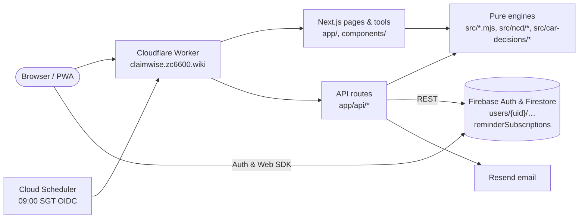

# Architecture

ClaimWise SG is a Next.js 15 application on Google Cloud Run (`asia-southeast1`) fronted by a Cloudflare Worker proxy (`https://claimwise.zc6600.wiki`). Pure modules in `src/` run all calculations and hold reference data such as clause-to-page mappings; `lib/` handles Firebase, Firestore, and Resend email.

## 1. System Overview

| Area | Routes | Where logic runs |
| --- | --- | --- |
| Home and car tools hub | `/`, `/tools` | `src/decision-engine.mjs`, `src/car-decisions/*.mjs` |
| Claim calculator, trajectory, stress test | `/calculator` | Server `POST /api/decision` (`src/decision-engine.mjs`, `src/claim-explanations.mjs`); browser (`src/trajectory-calculator.mjs`, `src/stress-test-calculator.mjs`) |
| Ownership cost, renewal, loan, and COE tools | `/tools/ownership-cost`, `/tools/ncd-protector`, `/tools/quote-compare`, `/tools/loan-prepayment`, `/tools/coe-renewal` | Browser: `src/car-decisions/*.mjs`, `src/ncd/premium-path.mjs` |
| My Car & email reminders | `/my-car`, `/reminders/*`, `/api/reminders/*` | `src/my-car.mjs`, `lib/my-car-service.js`, `src/reminders/*`, `lib/reminders/*` |
| Emergency kit & private settlement | `/emergency`, `/settlement` | `src/emergency-data.mjs`, `public/sw.js`, `src/settlement-form.mjs` |
| Rules, clauses, benchmarks | `/rules`, `/how-it-works`, `/api/rules`, `/api/clause-preview`, `/api/benchmarks` | `src/clause-documents.mjs`, `src/market-benchmarks.mjs` |

## 2. Shared Actuarial Core (`src/`)

- **Unified NCD model (`src/ncd/premium-path.mjs`)**: Implements `nextNcd`, `stepDownNcd`, `meetsProtectorMinimum`, `grossPremiumFromNet`, `renewalPremium`, `buildPremiumPath`, and `claimPremiumLossPresentValue`. The claim calculator, stress test, NCD Protector tool, and quote comparator all call it, pricing the same claim identically everywhere.
- **Engine vs. explanations**: `src/decision-engine.mjs` computes cash-flow numbers and break-even thresholds; `src/claim-explanations.mjs` builds advisory notices and policy clause audits. `src/numeric.mjs` clamps and sanitizes all inputs.

| Tool | Rule |
| --- | --- |
| Claim vs. self-pay | Effective excess (base + workshop + young-driver) + discounted NCD premium loss + PHV downtime/loading vs. repair cost |
| NCD Protector | Break-even claim risk = `rider cost ÷ 5-year discounted loss avoided` (neutral within 0.25 pts; claim period rounds down) |
| True monthly cost | depreciation to the deregistration value (or a resale estimate), Rule of 78 loan interest, LTA road tax by cc or kW with age surcharge, and running costs, per month owned |
| Quote comparison | `premium + accident probability × min(repair, excess + surcharge + 5-year NCD loss)` across 2–4 quotes |
| COE renewal | Equivalent annual cost of 5-yr PQP, 10-yr PQP, and replacement, charging PARF/COE/scrap as opportunity cost + road tax surcharge (10%/yr past age 10, max 50%) |
| Loan settlement | `remaining instalments − Rule of 78 rebate + fees/penalty` vs. alternative return (bisection break-even) |

## 3. History, My Car, and Reminders

- **Calculation history**: Guests save to `localStorage` (`claimwise_local_history`, max 20). Signed-in users write `users/{uid}/calculations/{id}` via `POST /api/decision` (with JWT pre-checks and `firestore.rules` enforcement) and sync local records on sign-in. Share links encode active core inputs, enabled flags, non-default rates, and PHV fields when `vehicleUsage` is `phv`.
- **My Car (`/my-car`)**: Stores one car (`claimwise_my_car` locally; `users/{uid}/vehicles/primary` when signed in, plate numbers excluded). Prefills `/calculator`, `/tools/ncd-protector`, and `/tools/quote-compare`.
- **Email reminders (`/api/reminders/*`)**: Double opt-in reminders 45d before renewal, 365d/90d before COE expiry, and 30d before loan review. Uses HMAC-hashed email IDs, constant-time signed tokens, rate limits (10/hr/IP, 24h cooldown, 200/day cap), OIDC-authenticated 09:00 SGT dispatch, Resend idempotency keys, and Firestore `updateTime` preconditions.

## 4. Infrastructure & Releases

- **Terraform (`infra/terraform/`)**: Manages GCP APIs, IAM, Secret Manager bindings, Firestore rules, Identity Platform, Cloud Scheduler, and Cloud Run settings (`gs://claimwise-sg-tfstate`).
- **GitHub Actions (`.github/workflows/`)**: `ci.yml` runs `npm test` and Documentation Guard; `pr-agent.yml` reviews and auto-merges safe PRs; `deploy.yml` and `terraform.yml` deploy to Cloud Run and GCP via keyless Workload Identity Federation. See [DEPLOYMENT_GUIDE.md](DEPLOYMENT_GUIDE.md).
