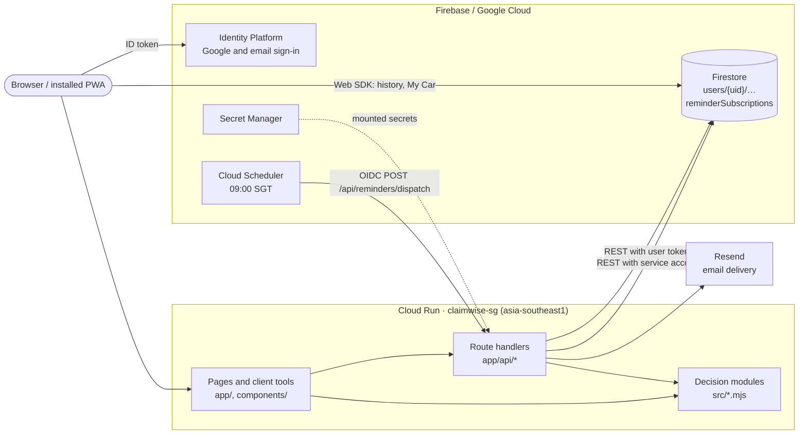
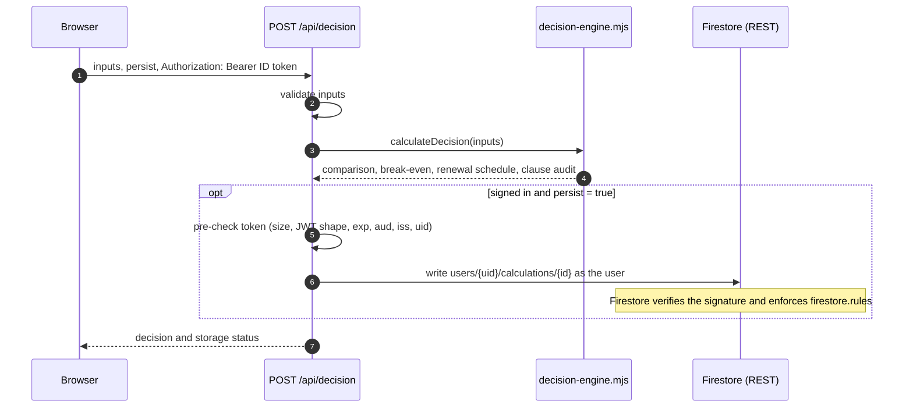
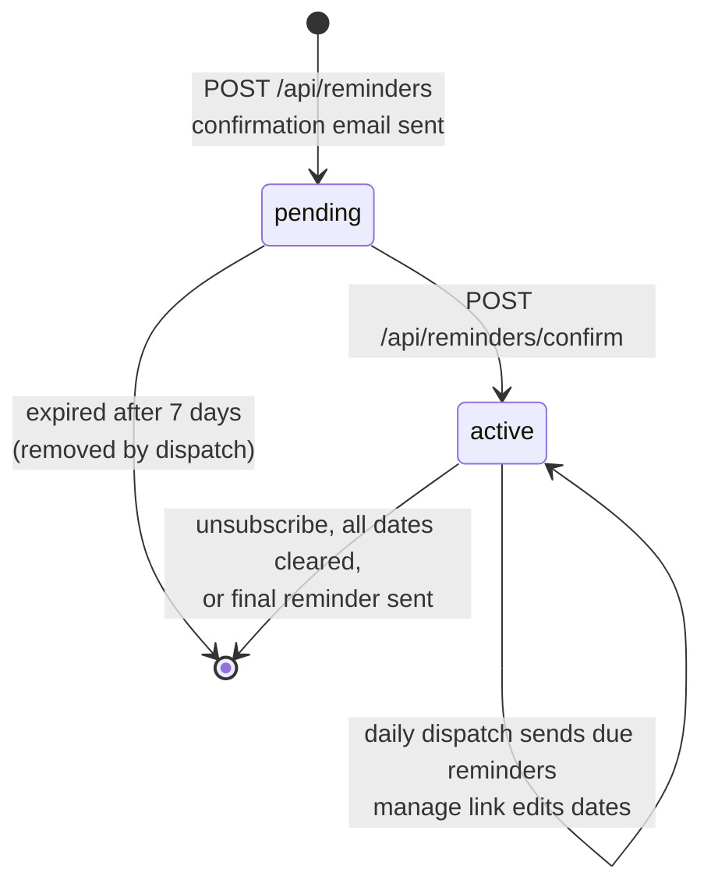
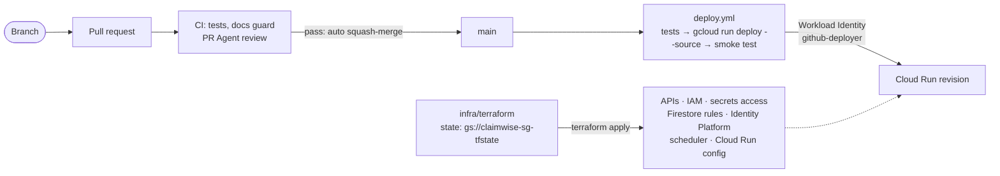

# ClaimWise SG Architecture

ClaimWise SG is a single Next.js 15 application on Cloud Run in Singapore. Pure, deterministic modules do the calculations; Firebase provides sign-in and per-user storage; a small server-side pipeline sends optional email reminders.

## 1. System Overview

| Area | Routes | Where the logic runs |
| --- | --- | --- |
| Claim vs. self-pay decision | `/calculator` | Server: `POST /api/decision` → `src/decision-engine.mjs` |
| Trajectory chart, stress test | `/calculator` results | Browser: `src/trajectory-calculator.mjs`, `src/stress-test-calculator.mjs` |
| Car decision tools | `/tools/*` | Browser: `src/car-decisions/*.mjs` |
| My Car | `/my-car` | Browser + Firestore Web SDK: `src/my-car.mjs`, `lib/my-car-service.js` |
| Email reminders | `/my-car`, `/reminders/*` | Server: `app/api/reminders/*` → `lib/reminders/*` |
| Private settlement | `/settlement` | Browser: `src/settlement-form.mjs` |
| Emergency kit (offline) | `/emergency` | Browser + service worker: `src/emergency-data.mjs`, `public/sw.js` |
| Policy clauses, rules, benchmarks | `/rules`, `/api/clause-preview`, `/api/rules`, `/api/benchmarks` | Server: `src/clause-documents.mjs`, `src/market-benchmarks.mjs` |

## 2. Decision Calculation and History

- **Requests**: The calculator requests a decision only on submit or recalculation.
- **Guests**: Records go to `localStorage` (`claimwise_local_history`, newest 20). Signed-in users fall back to it when Firestore is unreachable.
- **Sign-in sync**: `syncLocalCalculationsToCloud(user)` moves pending browser records into the user's Firestore subcollection.
- **History**: `components/CalculationHistory.jsx` subscribes through the Web SDK and shows cache, pending-write, server, or browser-fallback state. Opening a record shows the stored `decision` unchanged; **Recalculate & save** runs the current engine and saves a new record.
- **Sharing**: All 19 calculator inputs, including PHV downtime and loading fields, are encoded in the URL by `src/claim-share-link.mjs`, which ignores any invalid field when a link is opened and keeps the valid ones. Sharing captures unsubmitted edits, and a shared link recalculates once auth has settled.

## 3. Car Decision Tools

The landing page (`/`) links the claim calculator and four tools under `/tools/*`; `/tools` itself permanently redirects to `/`. The four tools call pure functions in `src/car-decisions/`. They make no API requests and store nothing on the server. Numeric helpers in `src/numeric.mjs` bound every input, so malformed values fall back to safe defaults instead of `NaN`.

All NCD premium modelling lives in `src/ncd/premium-path.mjs`: the step-down and recovery rules, NCD Protector eligibility, the renewal-premium path, and the present value of one claim's premium loss. The claim engine, the stress test, the NCD Protector tool, and the quote comparison all use it. The stress test passes the saved decision's insurer profile to `stepDownNcd` and `meetsProtectorMinimum`, so stored calculations replay under the terms they were made with, so every surface prices the same claim identically. The claim engine (`src/decision-engine.mjs`) computes figures only; the advisory notices and clause audit that explain them live in `src/claim-explanations.mjs`. `src/` holds only pure calculation modules; `lib/` holds code with side effects such as Firebase, storage, and email.

| Tool | Decision rule |
| --- | --- |
| NCD Protector | Prices the five-year renewal-premium loss of one at-fault claim with and without the rider using `claimPremiumLossPresentValue` from `src/ncd/premium-path.mjs`. Break-even probability = rider cost ÷ loss avoided; within 0.25 points is neutral. |
| Quote comparison | Ranks 2–4 quotes by premium + accident probability × cost per accident. Cost per accident is the cheaper of self-paying the repair and claiming, where claiming costs min(repair cost, excess + workshop surcharge) plus the five-year NCD loss at that quote's premium from the same helper. |
| COE renewal | Compares 5-year renewal, 10-year renewal, and replacement by equivalent annual cost. Deregistration value (PARF by cohort, pro-rated COE rebate, scrap) is an opportunity cost of renewing. Road tax rises 10% per year past age 10, up to 50%. |
| Loan settlement | Settlement = remaining instalments − Rule of 78 rebate + fees and penalty, compared with continuing at the alternative return; bisection finds the break-even return. |

## 4. My Car

`/my-car` keeps one car per viewer: a label, renewal, COE expiry and loan review dates, premium, NCD, and excess. Registration numbers are not collected.

- **Storage**: Each save writes a browser copy (`claimwise_my_car`) tagged with the owner's UID. Signed-in users also write `users/{uid}/vehicles/primary`; `firestore.rules` allows only that document, only for its owner, and only whitelisted, range-checked fields.
- **Reconciliation** (`useMyCar.js`): The account copy wins after sign-in. Signed-out details are uploaded only when the account has none, and another account's copy is never shown or adopted.
- **Prefill**: The NCD Protector and quote comparison tools read the saved premium, NCD, and excess.

## 5. Email Reminders

Optional, double opt-in emails before insurance renewal (45 days), COE expiry (365 and 90 days), and loan review (30 days), each linking to the matching tool.

| Route | Purpose |
| --- | --- |
| `POST /api/reminders` | Sign-up; sends a confirmation email |
| `POST /api/reminders/confirm` | Activates a subscription from a confirmation token |
| `POST /api/reminders/manage` | Reads or updates dates from a manage token |
| `POST /api/reminders/unsubscribe` | Deletes the subscription; also serves one-click `List-Unsubscribe` |
| `GET /api/reminders/unsubscribe` | Redirects to the manage page, because mail scanners prefetch links |
| `POST /api/reminders/dispatch` | Daily delivery; accepts only the scheduler's Google ID token for this audience |

The routes return 503 until `RESEND_API_KEY`, `REMINDER_FROM_EMAIL`, `REMINDER_SITE_URL`, and a `REMINDER_TOKEN_SECRET` of at least 32 characters are set.

**Privacy and abuse controls**
- The document ID is an HMAC of the normalised email, so addresses never appear in paths. Tokens are HMAC-signed and compared in constant time.
- Responses never reveal whether an address is subscribed; an active subscriber receives a manage link instead.
- Limits: 10 sign-ups per client per hour per instance, a 24-hour resend cooldown per address, and a shared cap of 200 sign-up emails per day. A hidden form field discards bot submissions.
- `reminderSubscriptions` is written only by the server with the Cloud Run service account; client access is denied by rules. Deleting a subscription removes the address.

**Dispatch guarantees**
1. A reminder is recorded only after Resend accepts it; idempotency keys (`{id}:{reminderKey}`) suppress duplicates from overlapping runs.
2. Writes use the document's `updateTime` precondition, so concurrent updates skip instead of overwriting.
3. A failed delivery moves `nextReminderDate` to tomorrow so failures cannot crowd out other due records.
4. Insurance renewal repeats yearly; the 12 most recent reminder keys prevent repeats.

## 6. Infrastructure and Releases

- **Terraform owns infrastructure**: APIs, IAM, secret access, Firestore rules, Identity Platform domains and Google sign-in, the reminder scheduler, and Cloud Run runtime settings. It ignores the container image because each release builds a new one. Secret values and the OAuth client secret are maintained outside Terraform.
- **GitHub Actions owns releases**: Every merge to `main` runs the tests, deploys the source, and smoke-tests the live service. Only workflows on `main` of this repository can obtain deploy credentials, and no service account key exists.
- **Offline support**: `public/sw.js` precaches the public pages so the emergency kit and tools open without a signal; bump its cache version when that list changes.
